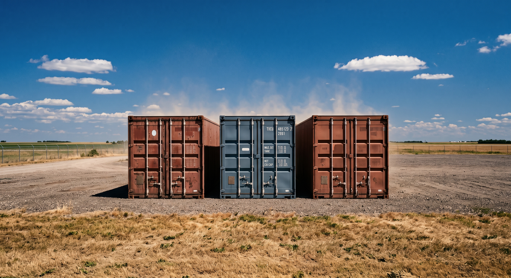
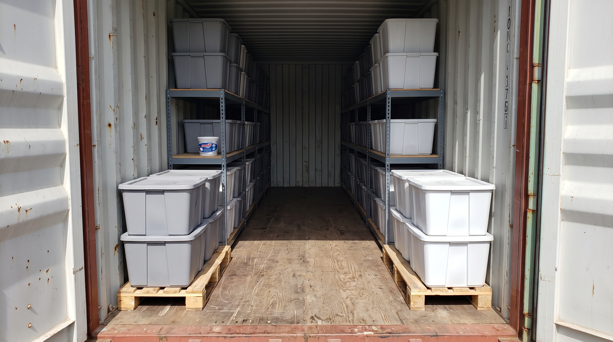

A shipping container is a great storage tool. It has steel walls and lockable doors. A Wind and Water Tight container also keeps out rain, wind, snow, and pests. Seals wear, so check them. But keeping out rain is not the same as controlling heat and cold inside. That gap causes most storage mistakes. Here are 12 things that don't belong in a container.

## Why a Sealed Container Still Isn't Safe for Everything

A closed, sealed steel box gets hot like a car in a parking lot. In summer, it can heat up fast under the sun. In winter, there's nothing inside to keep it warm. And overnight, the air inside can turn to water on the walls. It's like how a cold glass of lemonade sweats on a warm day. That's called condensation. It happens when warm, moist air touches cold metal. We explain [why a container "rains" inside, and how to stop it](/blog/why-does-my-container-rain-inside-condensation/), in its own guide.

How hot? GDV, the German insurers' cargo service, reports that one brown container measured about 50°C (122°F) inside when it was about 25°C (77°F) outside.

None of this means the container is broken. It's just physics acting on a big piece of bare metal. Anything that can't handle heat, cold, or being shut away from fresh air will struggle. A few things are outright unsafe. The 12 items below are the worst offenders in each group.

*Sealed steel baking in full summer sun. Watertight and secure outside doesn't mean climate-controlled inside.*

## Moisture-Sensitive Items

These items fail because of moisture in the air, not leaks. They can get ruined even in a container that never lets in a drop of rain.

### 1. Paper, books, and important documents
Paper soaks up moisture from the air. It can warp, get moldy, or grow mildew. This happens even if the container never leaks a drop. Photos and important papers are the most fragile. Once mold sets in, they are often ruined for good.

**What the experts say:** The Library of Congress says paper keeps best somewhere cool (room temperature or below) and fairly dry, with steady conditions. It says to avoid attics, basements, and other places with a high risk of leaks and environmental extremes.

If you store paper, use sealed plastic totes. Add a desiccant packet inside each tote. A desiccant packet is a small bag that soaks up extra moisture. It's like the little packet inside a new pair of shoes. Skip cardboard boxes on the floor.

### 2. Cardboard boxes themselves
Cardboard soaks up moisture like a sponge. This happens even if the box is empty. Damp cardboard can grow mold. It also gets weak and collapses under stacked weight. Use stackable plastic totes instead, especially for long-term storage.

**What the experts say:** Georgia Tech research found that boxes lose about a tenth of their stacking strength for every 10-point rise in humidity.

### 3. Cement, mortar, and other bagged dry mixes
Cement and mortar are made to set once water gets to them. Moisture can turn a good bag lumpy or hard before you ever open it. These dry mixes need a dry space, and a closed container can "sweat" on the inside as the weather changes. Keep bags up off the floor and away from the walls, and check the bag for any storage directions.

**What the experts say:** GDV says the largest sources of condensation in a closed container are the cargo, its packaging, and the wood floor. Paper bags sitting on that floor are right in the path of it.

### 4. Bare metal tools
Bare metal tools can rust when moisture builds up inside a container. A light coat of rust-preventing oil helps a lot. Keep tools off the floor and up on a shelf, too. Keeping tools on a job site? See our page on [jobsite tool storage](/for/contractors/).

**What the experts say:** GDV says condensation is most severe on the ceiling, where it doesn't dry out during the day and ends up dripping onto whatever is stored below.

## Temperature-Sensitive Items

These items fail because of temperature swings. A closed container can get very hot in summer. It can drop below freezing in winter. There's no thermostat inside a steel box.

### 5. Food that can spoil
In summer, the inside of a closed container gets much hotter than any pantry or fridge. In winter, it can freeze. Food that spoils doesn't belong in a container at any time of year.

**What the experts say:** University of Minnesota Extension says to store home-canned jars at 50 to 70°F, that temperatures over 100°F are harmful to canned foods, and that moisture can rust metal lids.

### 6. Live plants
Plants need light, steady temperatures, and fresh air. A sealed steel box has none of these. Even a short stay can cook or freeze a plant, depending on the season.

**What the experts say:** Container News, a shipping trade site, notes that the temperature inside a closed container often swings further than the air outside.

### 7. Electronics that hate heat and moisture
Electronics face two threats in a container. Moisture can corrode their metal contacts and circuit boards. "Corrode" just means slowly eaten away, like rust on an old bike. Heat can also wear out their batteries for good. If you must store electronics, check your maker's storage range first. Never leave them loose on a shelf.

**What the experts say:** For example, Apple says to store iPhone and iPad between -4°F and 113°F, and not to leave them in a car. Other makers list their own ranges, so check yours.

## Hazardous and Flammable Materials

These items are not just a storage problem. They are a safety problem. The honest answer for all of them is: ask a professional. Don't try a DIY workaround.

### 8. Propane tanks and other flammable gases
A closed container has little or no airflow. That makes it a bad place for anything that can leak, build pressure, or catch fire. Propane needs its own spot outdoors, away from heat and anything that could make a spark. Not sure how to store propane or gasoline safely? Ask your local fire department or your fuel supplier first.

**What the experts say:** North Carolina's Department of Agriculture says propane cylinders are to be stored outdoors, not indoors. For gasoline and other fuels, the limits come from your locally adopted fire code, so your local fire department is the one to ask.

### 9. Batteries, especially lead-acid
Lithium-ion batteries can catch fire if they are damaged or overheated, and heat raises that risk. If you store batteries in a container, keep them off the floor. Keep them at a steady temperature if you can. Keep them away from anything flammable. When in doubt, ask a battery store or your local hazardous-waste program.

**What the experts say:**
- **Lithium-ion tool batteries:** STIHL says to store its batteries dry and not outdoors, at a partial charge (not full or empty), between 14°F and 122°F.
- **Lead-acid batteries:** A Trojan Battery storage guide shows a battery left low on charge can freeze at about 19°F, a common winter-night low, while a fully charged one holds out to about -92°F. It says freezing usually ruins a battery.

### 10. Paint, solvents, and other chemicals
Paint and solvents have real fire and airflow rules. A solvent is a strong liquid that dissolves things, like paint thinner. Whether a storage container is an allowed place for them is a fire-code question, so check with your local fire department first. "It's probably fine" is not a safe answer here.

**What the experts say:** Dunn-Edwards, a paint maker, warns that latex paint can gel below 32°F. Check the can label or the product's data sheet for its storage range.

### 11. Ammunition and firearms
Rules for storing ammunition and firearms vary from state to state. A shipping container isn't built as secure storage for either one. This article can't give you a blanket yes or no. Follow your local and federal rules. Ask a professional if you're not sure what they are.

**What the experts say:** We could not find a storage temperature published by an official source that we could confirm, so we don't give one here. Follow the maker's label and the law where you live.

## Long-Term Problem Items

### 12. Rubber and tires, long-term
Sunlight, heat, and ozone age rubber. Tires stored for years somewhere hot can crack sooner than tires kept somewhere mild and dark. If you're storing tires for years, expect some wear no matter where they sit.

**What the experts say:** The U.S. Tire Manufacturers Association says to store tires clean, dry, out of the light, at mild temperatures, off the floor, and away from electric motors, which give off ozone.

*Sealed totes up on shelves and pallets beat boxes on the floor for almost everything on this list.*

## What to Do Instead

Once you know the pattern, most fixes are easy:

- **Paper and documents:** Use sealed plastic totes, not cardboard. Add a desiccant packet to each tote.
- **Batteries:** Store them on a shelf, away from anything flammable. Check on them often instead of sealing them up and forgetting them.
- **Electronics:** Check your maker's storage range before you store them. If the box will get hotter or colder than that, keep them indoors.
- **Anything sensitive to moisture:** Keep it off the floor and off the walls. Keep it away from bare metal. A little open space around it helps a lot.

These tips don't replace good airflow or a desiccant setup for the whole container. If you see moisture problems beyond this list, dry loading, desiccants, and better airflow can often cut them down. It's not a reason to avoid container storage altogether.

## Sources

- GDV / TIS (German Insurance Association cargo service), "Container climate": [tis-gdv.de](https://www.tis-gdv.de/tis_e/containe/klima/klima.htm)
- Library of Congress, preservation FAQ on storing paper: [ask.loc.gov](https://ask.loc.gov/preservation/faq/445765)
- Georgia Tech, "Effects of moisture content on box compression strength": [research.gatech.edu](https://research.gatech.edu/sites/default/files/2021-06/effects-of-moisture-content-on-box-compression-strength.pdf)
- University of Minnesota Extension, "Storing canned food": [extension.umn.edu](https://extension.umn.edu/preserving-and-preparing/storing-canned-food)
- Container News, "Rain in a box is precipitation with a cost": [container-news.com](https://container-news.com/rain-in-a-box-is-precipitation-with-a-cost/)
- Apple Support, iPhone and iPad operating and storage temperatures: [support.apple.com](https://support.apple.com/118431)
- North Carolina Department of Agriculture, proper storage of propane containers: [ncagr.gov](https://www.ncagr.gov/divisions/standards/standards-proper-storage-propane-containers)
- STIHL, battery storage: [stihl.ca](https://stihl.ca/en/project-guides/power-tool-maintenance/battery-care/battery-storage)
- Trojan Battery, deep cycle battery storage guide: [ressupply.com](https://ressupply.com/documents/trojan_battery/Deep_Cycle_Battery_Storage_Guide.pdf)
- Dunn-Edwards, paint storage best practices: [dunnedwards.com](https://www.dunnedwards.com/wp-content/uploads/2021/06/TB_Paint-Storage-Best-Practices.pdf)
- U.S. Tire Manufacturers Association, tire storage recommendations: [ustires.org](https://www.ustires.org/sites/default/files/Tire%20Storage%20Recommendations.pdf)
- CDC, "About Carbon Monoxide Poisoning": [cdc.gov](https://www.cdc.gov/carbon-monoxide/about/index.html)
- UK Health and Safety Executive, RR1178 (freight containers as confined spaces): [hse.gov.uk](https://www.hse.gov.uk/research/rrhtm/rr1178.htm)
- University of Pittsburgh EH&S, lithium-ion battery safety handbook: [safety.pitt.edu](https://www.safety.pitt.edu/sites/default/files/docs/SafetyHandbooks/02-009Lithium-IonBattery.pdf)
- RAND, child-access prevention laws (firearm storage rules by state): [rand.org](https://www.rand.org/research/gun-policy/analysis/child-access-prevention.html)
- JK Cement, how to store cement on site: [jkcement.com](https://www.jkcement.com/blog/construction-planning/how-to-store-cement-on-site/)
- GDV Container Handbook, section 10.3.6.4 (goods affected by slight moisture, including cement): [containerhandbuch.de](https://www.containerhandbuch.de/chb_e/scha/scha_10_03_06_04.html)

## Where to Go Next

This list covers the hard "don'ts." Most other [household](/for/homeowners/) and [business](/for/businesses/) items store just fine in a container. Just keep moisture and temperature swings in mind. Want the full rundown on what "Wind & Water Tight" does and doesn't cover? Visit our [condition guide](/condition/). For container sizes, markings, and specs, check the [container reference hub](/container-reference/).

---

Not sure what container size fits your stuff? Our [size guide](/size/) and our [complete container size chart](/blog/shipping-container-dimensions-size-chart/) walk through the options, or [get a real quote](/quote/) and we'll help you figure it out.
