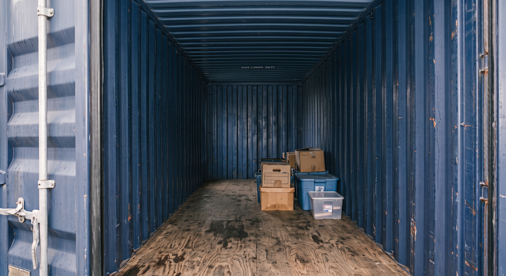
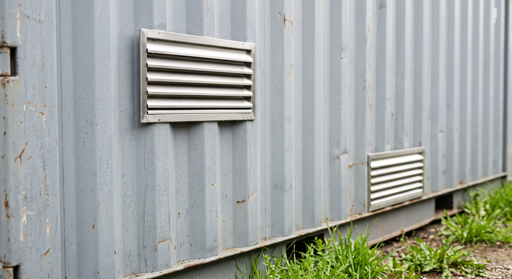

Water dripping from the ceiling of a closed container is usually condensation, not a leak. Warm, damp air inside the box touches cold steel and turns into drops. Most of that water came in with your stuff and the wood floor. Load dry, keep air moving around what you store, and watch the humidity.

Picture it. You open your container on a cool morning. The ceiling is dripping. Things under it look soaked, like they sat out in a storm. But the doors were shut, and it hasn't rained in a week.

That's condensation. People call it "container rain." Here's how to check for it, why it happens, and what helps.

## Leak or condensation? A 2-minute check

Look at two things: **where** the water is, and **when** it shows up.

- **Where.** Drops spread all over the ceiling and the top of the walls point to condensation. A wet trail that starts at one seam, corner, door edge, or roof spot points to a leak.
- **When.** Water that shows up after a cool night, on a dry day, points to condensation. Water that shows up right after rain, in the same spot each time, is worth a closer look.
- **The doors.** Open them and look at the rubber seals (gaskets) all the way around. Cracked, torn, or flat spots are where water and air can get in.

<!-- hs003-allow: "insurers'" only identifies GDV as the source organization; the sentence states where condensation forms, not what any insurer covers, requires, or accepts -->
The ceiling is where condensation does the most harm. GDV, the German insurers' cargo service, says condensation is most severe on the ceiling. Unlike the walls, the ceiling doesn't dry out during the day, so the water builds up and drips down onto the cargo.

Found a real leak? Every container we stock is used Wind & Water Tight, and our [condition guide](/condition/) explains the limited Lifetime Leak Warranty: we send a fiberglass patch kit you apply yourself.

## Why steel boxes sweat

Air always carries some water. You can't see it, but it's there. Warm air can hold more water than cold air. That's the whole trick.

Think of air like a sponge. A warm sponge can hold a lot of water. A cold sponge can't hold as much. When damp air touches your container's cold steel, it cools down fast, like a warm sponge turning cold. Now it can't hold all its water. So the extra water squeezes out, right onto the steel.

That cold point has a name: the **dew point**. It's the temperature where air has to let its water go. GDV puts it simply: when air is cooled below its dew point, for example by cold container walls, condensation forms. No leak. No broken seal. Just air doing what air does.

You've seen this before. A cold glass of water sweats on a hot day. A bathroom mirror fogs up after a hot shower. A shipping container does the same thing, only bigger.

*Condensation shows up first on the steel overhead (the ceiling and upper wall panels) before it reaches anything stored below.*

### When is it worst?

It's worst when warm, damp air is followed by a drop in temperature. The steel walls and roof warm up in the day and cool off at night. Container News, a shipping trade site, describes how those day-and-night swings drive condensation inside closed boxes. Damp air gets trapped during the warm part of the day. Then the steel cools below the dew point, and the water comes out as drops on the ceiling and walls.

So the weather on any given day matters more than the date on the calendar. A warm, muggy day followed by a cool night is the classic setup.

## Where the water comes from: your stuff and the wood floor

Here's the part most people miss. The water in "container rain" mostly isn't from outside. It's already inside.

GDV says the largest sources of condensation in closed containers are always the cargo, its packaging, and the wooden flooring. Container floors are wood laid over a steel frame. Cardboard, fabric, wood, and anything that went in wet all hold water. When the steel cools, that water comes out of the air and lands on the ceiling.

That's why GDV's advice for cargo is to load it "as dry as possible." A box packed on a rainy day, or a mower put away wet, brings water in with it. The EPA says wet things should be dried within 24 to 48 hours to help stop mold from growing.

## Container sweat vs. cargo sweat

GDV's Container Handbook splits this into two kinds of wet:

- **Container sweat** forms on the inside of the steel when the air temperature drops. It's the drip from the ceiling.
- **Cargo sweat** forms on your stuff itself when the temperature rises. Think of a can of soda pulled from the fridge on a warm day. The can gets wet even though nothing spilled on it.

Knowing which one you have tells you where to look. Drips from above mean the steel is cooling below the dew point. Wet spots right on your things, with no drip above them, can mean your things are colder than the dew point of the air reaching them, for example when you open the doors on a warm, humid day after a cold spell.

## What you can do with no tools

None of these steps need a drill, a saw, or power. They don't change the container. Used together, they cut down how much water forms.

### Load it dry

Wipe down or air out anything that's wet before it goes in. Don't pack on a rainy day if you can wait. Swap damp cardboard for sealed plastic totes. This goes right at GDV's biggest water sources: the cargo and its packaging.

### Get it off the floor

Set things on dry pallets (plastic, or wood that has been kept dry) or on freestanding shelves instead of right on the wood floor. The floor is one of the water sources GDV names, and anything sitting on it soaks that up. Off the floor, air can move under your stuff.

### Leave gaps at the walls and ceiling

Don't stack things tight against the steel or up to the ceiling. A few inches of open space lets air move and keeps your stuff out from under the worst drips. Keep the tallest stacks away from the spots where you've seen drops before.

### Use desiccants

Desiccants are packs or tubs that pull water out of the air. Cordstrap, a cargo-protection company, says desiccants absorb moisture in the air. Many desiccants sold for shipping containers use calcium chloride. Follow the package for how many to use and when to swap them out, and check them now and then. Moisture-sensitive things like paper, cardboard, and bare-metal tools need this most. They're near the top of our list of [things you should never store in a shipping container](/blog/12-things-never-store-in-a-shipping-container/) without a plan.

### Check the air with a hygrometer

A hygrometer is a small, low-cost meter that shows relative humidity (how full of water the air is). Set one inside and check it each time you open up. The EPA says to **keep indoor humidity low** to help prevent mold. If yours keeps reading high, add desiccants and look for wet things that went in.

### Check the door gaskets

The doors close against rubber gaskets. Gaskets wear over time. GDV notes that wear in the door area, time and time again, leads to leaks. An IMO guide for packing cargo containers shows ice formed from a leak in a door gasket, and says humid air getting in can cause condensation inside. Look over the gaskets a few times a year. If you see cracks or gaps, that's where to start.

## What a pro adds (and what to ask)

We sell every container as-is. We don't add vents, insulation, power, or anything else. Every container we stock is used Wind & Water Tight. New (one-trip) and Cargo Worthy containers are available by special request, and so is a 10ft. But no grade changes the physics: a new steel box can sweat too.

If the no-tools steps aren't enough for what you store, these are the usual add-ons. Each one is a change to the container, so it's a job for a container modification shop, an insulation contractor, or a licensed electrician. Any change you make is your call and your responsibility.

*Louvered vents like these are installed by a modification shop. We sell our containers as-is and don't add vents.*

### Passive vents

Vents let damp air inside trade places with outside air. The ISO code system even has a separate container type for ventilated boxes, with vents at the lower and upper parts. Questions to ask the shop:

- Where will the vents go, and how many?
- How will you seal and paint each cut so the box still keeps out rain and pests?
- Do the vents have screens?

### Powered vents with a humidistat

A powered vent uses a small fan. A humidistat is a sensor that turns the fan on only when the air gets too damp. Both need power. **Have a licensed electrician run any power into a steel container.** Skip the extension-cord setup.

### Insulation

Insulation keeps the inside steel closer to the temperature of the air inside, so it's less likely to drop below the dew point. Cordstrap describes insulation as a way to keep contents warmer than the dew point. It's the biggest job on this list. Questions to ask an insulation contractor:

- What type of insulation, and how is it attached?
- How will moisture be kept from getting trapped behind it?
- How does it change the inside size of the box?

### A circuit for a dehumidifier

A dehumidifier needs steady power. Ask a licensed electrician what the unit needs and how to set it up safely in a steel box.

### What about heat?

We don't sell or install heaters. **Never run a fuel-burning heater, generator, or engine inside a closed container.** The CDC says carbon monoxide is made any time you burn fuel, and calls it an odorless, colorless gas that kills without warning. If you want heat, talk to an HVAC pro.

## When a dehumidifier stops helping

A dehumidifier can help in a damp spot. But it has a limit worth knowing up front.

Home dehumidifiers are built for indoor rooms. GE, for example, says its models are designed to run above 41°F (5°C), that colder rooms cut how much water they remove, and that below 41°F the coils can frost over. A unit that works well in July might do very little on a cold night, and a temperature drop is exactly when condensation forms.

Before you count on one, check the operating temperature on the unit's spec sheet. Check whether the maker allows use in an unheated outbuilding. And keep the no-tools steps going. Dry loading, pallets, gaps, and desiccants keep working no matter how cold it gets.

## Wind & Water Tight is not climate control

This is an easy mix-up to make.

**Wind & Water Tight (WWT)** means the box keeps out rain, wind, snow, and pests, with no holes and doors that seal. Seals wear, so check them. Our [condition guide](/condition/) has the full grade, and [what "Wind & Water Tight" actually means](/blog/wind-and-water-tight-explained/) breaks it down in plain English.

WWT is about keeping weather out. It says nothing about the air already inside. Controlling that air takes insulation plus heat, cooling, or a dehumidifier. That's climate control, and it's a separate job from the box itself.

So if your WWT container "rains" inside, that by itself doesn't mean a seal failed. It's what a closed steel box does when damp air meets cold steel. If you do see water coming in at a seam, corner, or the roof right after rain, that's different. Our [container reference](/container-reference/) page covers container markings and specs.

## Sources

- GDV / TIS (German Insurance Association cargo service), "Container climate": [tis-gdv.de](https://www.tis-gdv.de/tis_e/containe/klima/klima.htm)
- GDV Container Handbook, section 10 (container sweat and cargo sweat): [containerhandbuch.de](https://www.containerhandbuch.de/chb_e/scha/scha_10_00.html)
- U.S. EPA, "A Brief Guide to Mold, Moisture and Your Home" (keep indoor humidity low; dry wet materials within 24 to 48 hours): [epa.gov](https://www.epa.gov/mold/brief-guide-mold-moisture-and-your-home)
- Container News, "Rain in a box is precipitation with a cost": [container-news.com](https://container-news.com/rain-in-a-box-is-precipitation-with-a-cost/)
- Cordstrap, "The top four ways to reduce the impact of container rain": [cordstrap.com](https://cordstrap.com/en/products/moisture-control/the-top-four-ways-to-reduce-the-impact-of-container-rain/)
- IMO MSC.1/Circ.1498, informative material for the CTU Code (door gasket leak; humid air and condensation; para 15.1, moisture from packing during rain or snow): [mardep.gov.hk](https://www.mardep.gov.hk/en/msnote/pdf/msin1669anx2.pdf)
- BIC, ISO 6346 size and type code table (ventilated container type): [bic-code.org](https://www.bic-code.org/wp-content/uploads/2018/01/SizeAndType-Table1-3.pdf)
- GE Appliances, dehumidifier owner's manual 49-5000428 (operation above 41°F / 5°C): [homedepot-static.com](https://images.homedepot-static.com/catalog/pdfImages/61/615338bf-8aeb-4781-8951-c8fda04a6eea.pdf)
- CDC, "About Carbon Monoxide Poisoning": [cdc.gov](https://www.cdc.gov/carbon-monoxide/about/index.html)

---

Buying a used container and want the full picture on what "Wind & Water Tight" covers? [See our condition guide](/condition/), or [get a real quote](/quote/) and we'll walk you through what you're buying.
